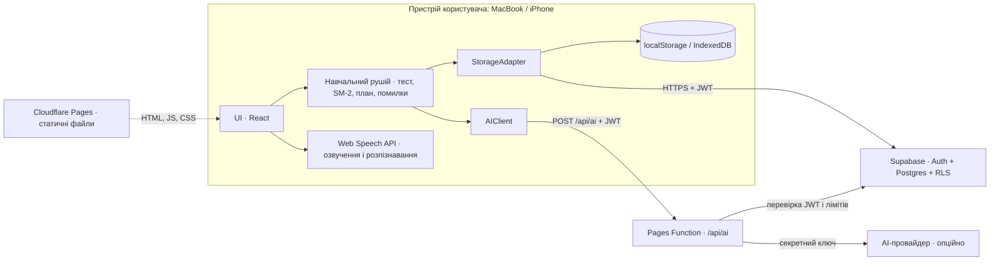
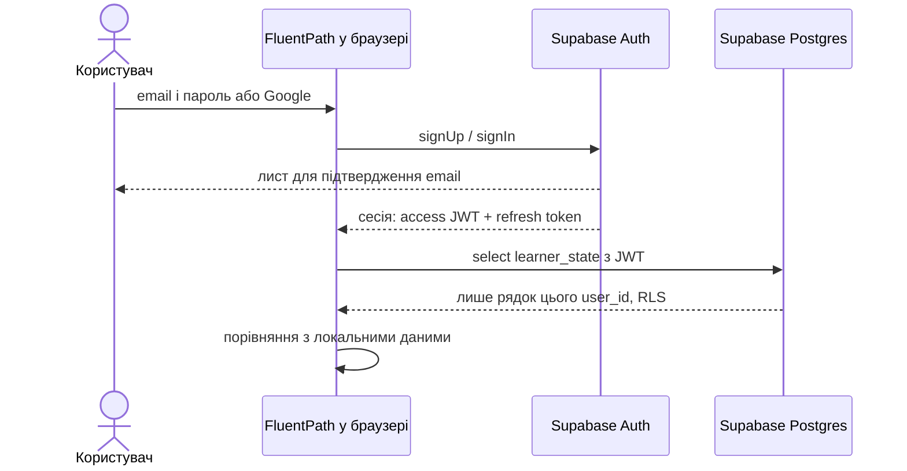
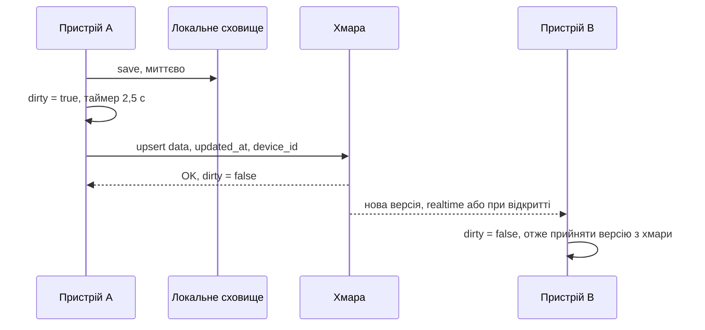
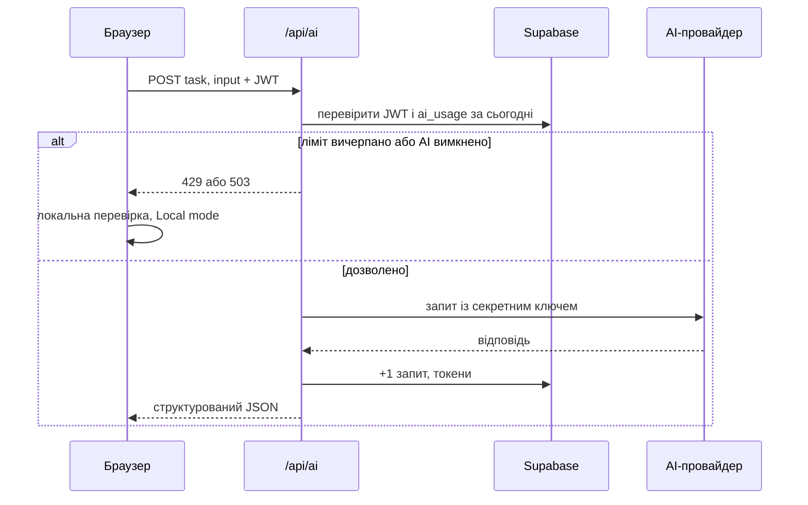

FluentPath AI · технічна документація · версія 1

# Як влаштований FluentPath AI

FluentPath — вебзастосунок для вивчення англійської до рівня C1. Уся навчальна логіка працює в браузері. Сервер потрібен лише для трьох речей: акаунтів, хмарної копії прогресу та безпечного доступу до AI. Документ описує поточний стан і цільову архітектуру; кожен компонент позначено статусом.

- **Frontend:** Статичний SPA — зараз — один index.html; далі React + TS + Vite
- **Хостинг:** Cloudflare Pages — CDN, HTTPS, без серверів
- **Backend:** Supabase — Auth + Postgres + Row Level Security
- **AI:** Опційний проксі — функція /api/ai, ключ лише на сервері

## Коротко

Це **local-first** застосунок. Браузер зберігає всі дані користувача локально й працює без інтернету та без реєстрації. Якщо користувач увійшов в акаунт, той самий стан у фоні копіюється в базу даних, щоб прогрес був однаковий на ноутбуці й телефоні. Якщо підключено AI, складні перевірки (письмо, діалоги) йдуть через серверну функцію; без AI застосунок використовує локальні правила.

- **1. Застосунок працює без сервера** Сервер лише додає можливості: синхронізацію і AI. Його недоступність не ламає навчання.
- **2. Жодних секретів у браузері** У фронтенді лише публічні ключі. Ключ AI і службовий ключ бази живуть тільки в серверній функції.
- **3. Кожен бачить лише своє** Кожна таблиця має `user_id` і політику RLS: база сама відмовляє в доступі до чужих рядків.

## Карта системи

Цільова архітектура. Стрілки — напрям запитів. Усе в блоці «Пристрій» виконується в браузері.



- **Cloudflare Pages** — Роздає статичні файли через CDN. Логіки на сервері немає, окрім однієї функції `/api/ai`.
- **Навчальний рушій** — Чисті функції без UI: адаптивний тест рівня, інтервальне повторення SM-2, генерація плану уроку, журнал помилок, локальна перевірка тексту.
- **StorageAdapter** — Єдина точка збереження. Пише локально миттєво, а в хмару — з затримкою 2,5 с, і розв’язує конфлікти між пристроями.
- **Supabase** — Реєстрація та вхід (email/пароль, Google), Postgres для хмарної копії, RLS для ізоляції користувачів.
- **/api/ai** — Серверний проксі до AI-провайдера: перевіряє користувача, рахує ліміти, тримає секретний ключ. Вимкнений, поки власник не дозволить витрати.
- **Web Speech API** — Вбудоване в браузер озвучення й розпізнавання мовлення. Аудіо не проходить через наш сервер і не зберігається.

## Що готово, а що заплановано

| Компонент | Статус | Деталі |
|---|---|---|
| UI, 12 розділів, тема, персонаж Echo | **[Готово]** | Працює в прототипі: один файл `index.html`, ванільний JS. |
| Навчальний рушій | **[Готово]** | Адаптивний тест, SM-2, план уроку, журнал помилок, локальна перевірка тексту (26 правил). |
| Локальне збереження | **[Готово]** | `localStorage`, версія схеми, міграції, експорт/імпорт JSON. |
| Окремий сайт | **[Готово]** | Пакет для Cloudflare Pages: `index.html`, іконки, маніфест, заголовки безпеки. |
| Хмарна синхронізація | **[Прототип]** | Працює лише у версії на claude.ai (акаунт Claude + приватне сховище сторінки). На окремому сайті її замінить Supabase. |
| Проєкт React + TypeScript + Vite | **[Заплановано]** | Фаза B: розбиття файлу на модулі за структурою нижче. |
| Supabase: акаунти й база | **[Заплановано]** | Фаза F: таблиці й політики з розділу «Модель даних». |
| Функція /api/ai | **[Заплановано]** | Фаза F: вмикається лише після погодження бюджету. |
| Автотести | **[Частково]** | E2E-сценарії на Playwright уже проганяються; unit-тести рушія — у Фазі E. |

## Структура коду

Цільова структура репозиторію. Принцип: **логіка окремо від інтерфейсу**. Папку `engine/` можна тестувати без браузера.

```
fluentpath/
├─ site/                  ← поточний прототип, готовий до деплою (один index.html)
├─ src/
│  ├─ app/                маршрутизація, layout, тема
│  ├─ features/           екрани: dashboard, placement, lesson, speaking, listening,
│  │                      reading, writing, grammar, vocabulary, progress, mistakes, settings
│  ├─ engine/             чиста логіка без UI
│  │  ├─ sm2.ts           інтервальне повторення
│  │  ├─ placement.ts     адаптивний тест і оцінка рівня
│  │  ├─ planner.ts       склад щоденного уроку
│  │  ├─ mistakes.ts      журнал помилок і закономірності
│  │  └─ textCheck.ts     локальні правила перевірки письма
│  ├─ content/            банк завдань, тексти, граматика, маршрут CEFR (JSON/TS)
│  ├─ data/
│  │  ├─ schema.ts        тип LearnerState + номер версії + міграції
│  │  ├─ localAdapter.ts  збереження в браузері
│  │  ├─ supabaseAdapter.ts хмарна копія
│  │  └─ sync.ts          алгоритм синхронізації і конфліктів
│  ├─ services/
│  │  ├─ auth.ts          обгортка над Supabase Auth
│  │  ├─ ai.ts            клієнт /api/ai з резервом на локальний режим
│  │  └─ speech.ts        TTS / розпізнавання мовлення
│  ├─ echo/               персонаж: SVG + анімаційний рушій
│  └─ ui/                 спільні компоненти: Button, Card, Stage, ProgressBar
├─ functions/api/ai.ts    серверна функція Cloudflare (AI-проксі)
├─ supabase/migrations/   SQL: таблиці + RLS-політики
├─ tests/                 unit (Vitest) + e2e (Playwright)
├─ .env.example
└─ README.md
```

> У поточному `index.html` код уже розбитий на ті самі блоки з коментарями-заголовками (`/* ===== SRS (SM-2) ===== */`, `/* ===== account & cloud sync ===== */` тощо). Перенесення в модулі — механічна робота, логіку переписувати не потрібно.

## Ключові інтерфейси

Три інтерфейси відокремлюють застосунок від конкретних сервісів. Заміна Supabase чи AI-провайдера не зачіпає UI й рушій.

```
// data/StorageAdapter.ts — куди зберігається прогрес
export interface StorageAdapter {
  load(): Promise<LearnerState>;
  save(state: LearnerState): Promise<void>;               // локально одразу, у хмару з затримкою
  subscribe(onRemote: (snap: RemoteSnapshot) => void): () => void;
}

// services/auth.ts — хто користувач
export interface AuthProvider {
  current(): Promise<User | null>;
  signUp(email: string, password: string): Promise<User>;
  signIn(method: "password" | "google", creds?: Credentials): Promise<User>;
  resetPassword(email: string): Promise<void>;
  signOut(): Promise<void>;
}

// services/ai.ts — розширені перевірки
export interface AIProvider {
  available(): Promise<boolean>;                          // false → застосунок працює в Local mode
  writingFeedback(input: WritingInput): Promise<WritingFeedback>;
  dialogueTurn(input: DialogueInput): Promise<DialogueTurn>;
}
```

| Інтерфейс | Реалізації |
|---|---|
| `StorageAdapter` | `LocalAdapter` **[готово]** · `ClaudeArtifactAdapter` **[прототип]** · `SupabaseAdapter` **[план]** |
| `AuthProvider` | Немає акаунта (локальний профіль) **[готово]** · акаунт Claude **[прототип]** · Supabase Auth **[план]** |
| `AIProvider` | `LocalRules` **[готово]** · `ServerAI` через `/api/ai` **[план]** |

## Модель даних

### Стан користувача (LearnerState)

Увесь прогрес — один JSON-документ із номером версії схеми. Коли структура змінюється, номер зростає, а функція `migrate()` переводить старі дані в новий формат. Так влаштовано вже зараз.

```
{
  "schema": 1,                        // версія структури
  "updatedAt": 1793447422000,         // час останньої зміни (мс)
  "account":   { "name": "Vlad", "mode": "cloud" },
  "profile":   { "minutes": 30, "days": [1,2,3,4,5], "focus": "speaking", "goals": ["work"] },
  "placement": { "overall": "B1", "skills": { "grammar": {"lv":"B1"}, "writing": {"lv":null} } },
  "vocab":     [ { "en": "reliable", "uk": "надійний", "ef": 2.5, "interval": 6, "due": "2026-11-06", "hist": [] } ],
  "mistakes":  [ { "cat": "prepositions", "user": "depend of", "expected": "depend on", "count": 2, "next": "2026-11-02" } ],
  "sessions":  [ { "d": "2026-10-31", "skill": "reading", "correct": 3, "total": 3, "min": 6 } ],
  "grammar":   { "ppps": { "attempts": [ { "d": "2026-10-31", "ok": true } ] } },
  "lesson":    { "count": 12, "lastDate": "2026-10-31", "current": null },
  "settings":  { "theme": "dark", "voice": "", "rate": 1, "micConsent": false }
}
```

### Таблиці Supabase, етап 1

Перший етап дзеркалить поточну синхронізацію: **один рядок на користувача** з JSON-знімком стану. Це просто, надійно й вкладається в безкоштовний план. Нормалізовані таблиці (картки, помилки, сесії окремо) знадобляться лише для серверної аналітики — це етап 2.

```
-- supabase/migrations/001_learner_state.sql
create table public.learner_state (
  user_id    uuid primary key references auth.users(id) on delete cascade,
  schema     int         not null,
  data       jsonb       not null,
  device_id  text        not null,
  updated_at timestamptz not null default now()
);
alter table public.learner_state enable row level security;

create policy "own state: read"   on public.learner_state for select using (auth.uid() = user_id);
create policy "own state: insert" on public.learner_state for insert with check (auth.uid() = user_id);
create policy "own state: update" on public.learner_state for update
  using (auth.uid() = user_id) with check (auth.uid() = user_id);
create policy "own state: delete" on public.learner_state for delete using (auth.uid() = user_id);

-- облік використання AI: клієнт лише читає, пише тільки серверна функція
create table public.ai_usage (
  user_id    uuid references auth.users(id) on delete cascade,
  day        date not null default current_date,
  requests   int  not null default 0,
  tokens_in  int  not null default 0,
  tokens_out int  not null default 0,
  primary key (user_id, day)
);
alter table public.ai_usage enable row level security;
create policy "own usage: read" on public.ai_usage for select using (auth.uid() = user_id);
```

> Видалення акаунта (`on delete cascade`) автоматично видаляє всі рядки користувача. Повне видалення даних є і в самому застосунку (Налаштування → Видалити всі дані).

## Основні потоки

### Реєстрація і вхід



### Синхронізація між пристроями

Кожне збереження спершу йде в браузер, тому інтерфейс ніколи не чекає мережі. Потім стан відправляється в хмару з затримкою 2,5 с, щоб об’єднати серію змін в один запис.



Конфлікти визначаються не за годинниками пристроїв (вони можуть розходитися), а за прапорцем «на цьому пристрої є невідправлені зміни»:

| Хмара змінилася на іншому пристрої? | Тут є невідправлені зміни? | Дія |
|---|---|---|
| Ні | Ні | Нічого, усе синхронізовано |
| Ні | Так | Відправити локальну версію |
| Так | Ні | Прийняти версію з хмари |
| Так | Так | Показати користувачу вибір, яку версію залишити; нічого не перезаписувати мовчки |

### Запит до AI



### Голос

Озвучення та розпізнавання мовлення виконує браузер через Web Speech API, без нашого сервера. У Chrome і Safari розпізнавання може обробляти сервіс Google або Apple. Застосунок зберігає лише текст транскрипції, аудіо не записує, а перед першим використанням мікрофона просить згоди.

## API: POST /api/ai **[план]**

Єдиний серверний ендпоінт. Приймає задачу певного типу й повертає строго структурований JSON, щоб UI не залежав від формату відповіді конкретної моделі.

```
// запит
POST /api/ai
Authorization: Bearer <Supabase access JWT>
{
  "task": "writing_feedback",            // | "dialogue_turn" | "explain_mistake"
  "level": "B1",
  "input": { "prompt": "Describe a memorable day", "text": "Last summer I go to Lviv..." }
}

// відповідь 200
{
  "corrected": "Last summer I went to Lviv...",
  "issues": [ { "from": "go", "to": "went", "type": "grammar", "explain_uk": "Минулий час: last summer → Past Simple." } ],
  "scores": { "task": 4, "organisation": 3, "accuracy": 3, "range": 3 },
  "next_task": "Напишіть 3 речення про минулі вихідні в Past Simple.",
  "usage": { "requests_today": 7, "limit": 30 }
}
```

| Код | Коли | Що робить застосунок |
|---|---|---|
| `400` | Невідомий `task` або текст довший за ліміт (4 000 символів) | Показує, що виправити |
| `401` | Немає JWT або він недійсний | Просить увійти знову |
| `429` | Вичерпано денний ліміт запитів | Локальна перевірка + повідомлення про ліміт |
| `502` | Помилка або таймаут AI-провайдера (20 с) | Локальна перевірка, можна повторити |
| `503` | AI вимкнено (`AI_ENABLED=false`) | Local mode без помилок |

## Безпека і приватність

- **Ізоляція даних:** RLS на кожній таблиці. Навіть якщо в коді фронтенду помилка, база не віддасть чужі рядки.
- **Ключі:** у браузері лише `anon`-ключ Supabase. Він публічний за задумом, а захист забезпечує RLS. `service_role` і ключ AI — тільки в змінних серверної функції.
- **Заголовки:** Content-Security-Policy (скрипти й з’єднання лише з власного домену; шрифти з Google Fonts), заборона вбудовування в iframe, `nosniff`, мікрофон дозволено лише власному домену. Файл `_headers` уже є в пакеті сайту.
- **Аудіо:** не зберігається; мікрофон вмикається лише після явної згоди.
- **Контроль даних:** експорт усіх даних у JSON, імпорт, повне видалення.
- **Витрати:** AI вимкнений за замовчуванням; денний ліміт на користувача і загальний вимикач `AI_ENABLED`.

## Змінні середовища

| Змінна | Де використовується | Секрет? | Призначення |
|---|---|---|---|
| `VITE_SUPABASE_URL` | Браузер | Ні | Адреса проєкту Supabase |
| `VITE_SUPABASE_ANON_KEY` | Браузер | Ні | Публічний ключ; доступ обмежує RLS |
| `SUPABASE_URL` | Функція /api/ai | Ні | Адреса проєкту для серверних запитів |
| `SUPABASE_SERVICE_ROLE_KEY` | Функція /api/ai | **Так** | Обходить RLS; лише для запису `ai_usage` |
| `AI_API_KEY` | Функція /api/ai | **Так** | Ключ AI-провайдера |
| `AI_ENABLED` | Функція /api/ai | Ні | Загальний вимикач, за замовчуванням `false` |
| `AI_DAILY_REQUESTS` | Функція /api/ai | Ні | Ліміт запитів на користувача на день |

Змінні з префіксом `VITE_` потрапляють у зібраний фронтенд, тому секретів із таким префіксом бути не може. Серверні змінні задаються в налаштуваннях Cloudflare Pages і ніколи не комітяться.

## Деплой

### Зараз: пряме завантаження

1. Папка `site/` містить готовий сайт: `index.html`, іконки, маніфест, `_headers`.
1. У Cloudflare Pages створюється проєкт через Direct Upload, і папка перетягується в браузер.
1. Сайт отримує адресу `.pages.dev` з HTTPS. Оновлення — нове завантаження папки.

### Далі: з GitHub

1. Код у репозиторії GitHub; Cloudflare Pages підключається до нього.
1. Збірка: `npm run build`, вихідна папка `dist`; функції з `functions/` розгортаються автоматично.
1. Кожен push у `main` оновлює сайт; кожна гілка отримує окрему preview-адресу.
1. Міграції бази з `supabase/migrations/` застосовуються через SQL Editor або Supabase CLI.

## Вартість

- **Хостинг і база:** у Cloudflare Pages і Supabase є безкоштовні плани, яких вистачає для старту. Їхні ліміти змінюються, тому перевіряємо актуальні умови в момент підключення й не закладаємо їх у код.
- **AI:** вартість = кількість токенів × ціна провайдера. Поки власник не погодив бюджет, `AI_ENABLED=false` і витрати нульові. Після ввімкнення витрати обмежує денний ліміт на користувача; ціль — до $5–10 на місяць.
- **Голос:** безкоштовно, бо працює в браузері.

## Тестування

- **Уже є (E2E, Playwright):** повний тест рівня, налаштування плану, урок від початку до кінця, словник (картки, spelling), письмо, говоріння, журнал помилок, реєстрація, синхронізація з імітацією хмари (два пристрої і конфлікт), робота окремого сайту з продакшн-заголовками, ширина iPhone без горизонтальної прокрутки.
- **Заплановано (unit, Vitest):** `sm2.ts` (інтервали й коефіцієнт легкості), `placement.ts` (оцінка рівня на граничних відповідях), `textCheck.ts` (кожне правило — приклади з помилкою і без), `sync.ts` (усі чотири рядки таблиці конфліктів).
- **Заплановано (безпека):** тест RLS — користувач B не може прочитати чи змінити рядок користувача A.

## Глосарій

- **SPA** — Single Page Application: сайт, який після першого завантаження працює в браузері без перезавантаження сторінок.
- **Local-first** — Дані спершу зберігаються на пристрої, а сервер лише синхронізує копію.
- **RLS** — Row Level Security: правила Postgres, що визначають, які рядки бачить конкретний користувач.
- **JWT** — Підписаний токен сесії; сервер перевіряє з нього, хто робить запит.
- **Pages Function** — Невелика серверна функція, яку Cloudflare запускає на запит до певної адреси (тут `/api/ai`).
- **SM-2** — Алгоритм інтервального повторення: що легше згадуєте слово, то рідше воно з’являється.
- **CEFR** — Загальноєвропейська шкала рівнів мови A1–C2. У застосунку — орієнтир, а не сертифікат.

FluentPath AI · Small steps. Big fluency. Документ оновлюється разом із кодом.
